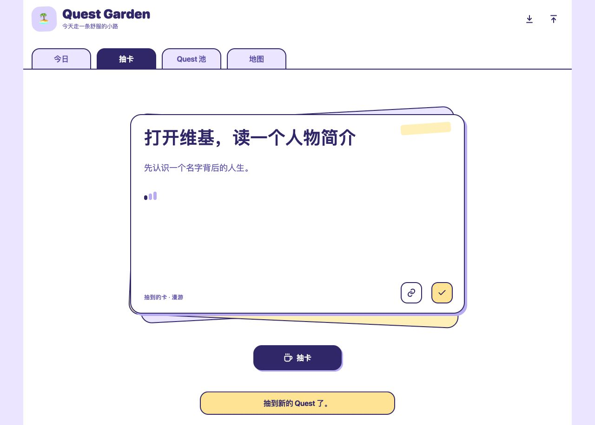
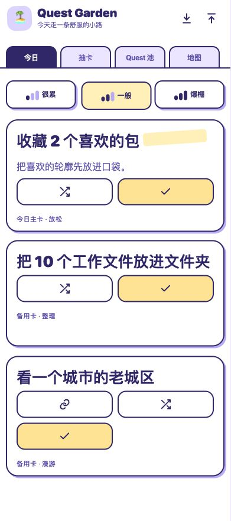

# Quest Garden

**无聊时，抽一张卡。**

有时空出几分钟，想找点事做，却一下子想不到做什么。我做了这个小花园，把可以随手开始的事做成卡片。抽到一张，就去画五分钟、逛逛地图，或者整理桌面的一小角。今天没兴致，换一张就好。

[在线抽一张](https://dounaoo.github.io/quest-garden/) · [打开 Tiiny 原版](https://cxygarden.tiiny.site/)

## 怎么玩

- **抽卡**　随机抽一件小事，想做就做，做完点「完成」。不合心意可以再抽。
- **今日**　选「很累」「一般」或「爆棚」，看看今天的主卡和备用卡。
- **Quest 池**　按放松、灵感、漫游、创作、整理或项目找卡，也可以把自己的点子加进去。
- **地图**　回看最近完成过的小事。

## 在本地打开

用浏览器打开 `index.html`，也可以在项目目录运行 `python3 -m http.server 8000`，然后访问 `http://localhost:8000`。页面由原生 HTML、CSS 和 JavaScript 编写，无需安装依赖或构建。

任务和完成记录存在当前浏览器。要把 Tiiny 里的记录带到新地址，先在旧站点点击「导出备份」，再到新站点点击「导入备份」。导入会替换当前站点的记录。
